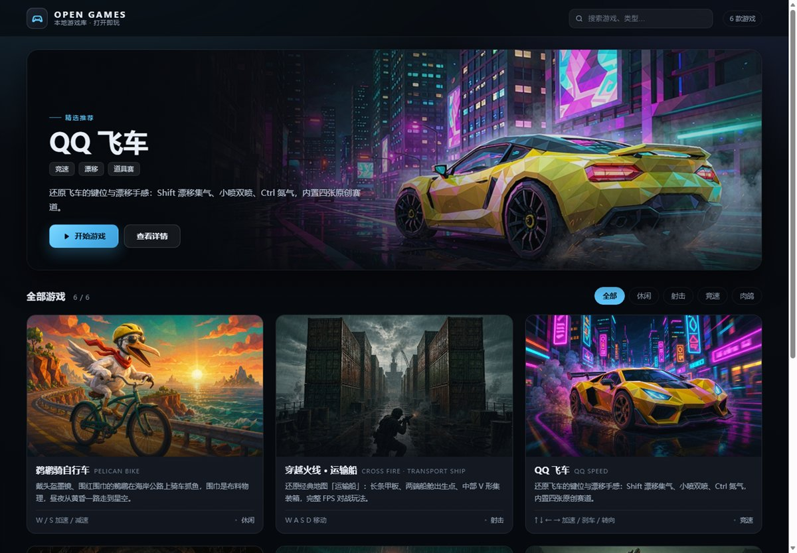
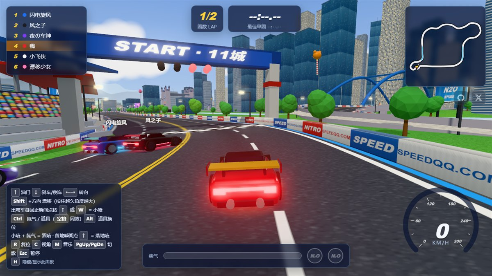
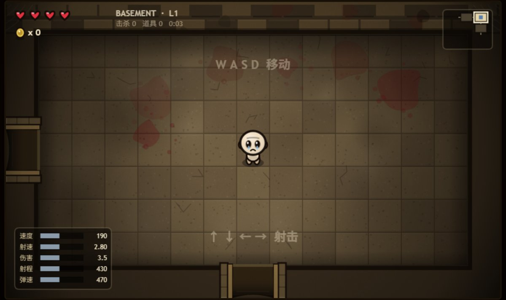

# Open-Games · 飞牛 fnOS 游戏合集

把开源网页游戏整理成飞牛 NAS 应用：应用中心装好后，桌面出现一个图标，点开是类 Steam 的游戏库面板，点任意游戏封面即在新标签页直接开玩。

当前内置十三款游戏（模型 / 纹理 / 音效均由代码程序化生成或随包内置；两款体积较大的游戏在首次运行时按需下载，之后离线可玩）：

| 游戏 | 类型 | 说明 | 开源地址 |
| --- | --- | --- | --- |
| 🚲 鹈鹕骑自行车 | 海岸公路休闲骑行 | 布料物理围巾、昼夜循环、实时合成音乐，14 个成就 / 5 种镜头 | [riba2534/claude-opus-5-5-demo · pelican-bike](https://github.com/riba2534/claude-opus-5-5-demo/tree/main/pelican-bike) |
| 🔫 穿越火线 · 运输船 | FPS 团队枪战 | 考据还原「运输船」地图，枪械弹道与后坐力、bots 对战、击杀播报 | [riba2534/claude-opus-5-5-demo · cf-transport-ship](https://github.com/riba2534/claude-opus-5-5-demo/tree/main/cf-transport-ship) |
| 🎯 几猫 · 国产 3A 大作 | 单关 FPS | 雨夜集装箱港口，切断三个上行链路中继器，躲开无人机与机器狗，1.4 MB 单文件 | [realcodebear/saltline-fable-5.2](https://github.com/realcodebear/saltline-fable-5.2) |
| 🪖 铁幕行动 · 仓库区 | 单关 FPS | 3 分钟清空仓库区 10 名敌人，四把枪各自机瞄倍率，二段跳 / 攀越，界面已中文化 | [StarKnightt/operation-ironhold](https://github.com/StarKnightt/operation-ironhold) |
| 🏎️ QQ 飞车 | 竞速漂移 | 漂移集气、小喷 / 双喷 / 氮气、四张原创赛道、道具赛 | [riba2534/claude-opus-5-5-demo · qq-speed](https://github.com/riba2534/claude-opus-5-5-demo/tree/main/qq-speed) |
| 👶 以撒的结合 · 地下室的束缚 | 肉鸽弹幕地牢 | 12 层随机地牢、13 个 Boss、11 种敌人、55 件可叠加道具，Canvas 全程序化绘图 | [liyupi/binding-of-isaac-webgame](https://github.com/liyupi/binding-of-isaac-webgame) |
| 🌸 粉彩核弹小镇 | 3D 死斗 FPS | 马卡龙色的 Nuketown 街区，25 击杀死斗、8 个机器人、25 级赛季通行证、皮肤商店，界面已中文化 | —（由 `app/nuketown/` 源码构建） |
| 🗡️ 地牢探险 | 地牢冒险 | 随机房间逐层下潜，哥布林 / 骷髅兵 / 暗影 / 恶魔，捡装备攒金币找神器，界面已中文化 | it-stud.io 单文件页（已汉化） |
| 🧱 俄罗斯方块 | 益智休闲 | 七种方块、消行升级加速，下一个方块预览与得分统计，界面已中文化 | it-stud.io 单文件页（已汉化） |
| 🌫️ 雾港 · 断电行动 | 单关 FPS | 雨雾港区关三座信标再撤离，无人机与四足守卫、三档画质、触屏操作，0.82 MB 断网可玩 | [chencheng666/mist-harbor](https://github.com/chencheng666/mist-harbor) |
| 🎻 无声山谷 | 第三人称动作 RPG | 唤醒八座沉默尖塔：清庭院、敲钟、调音，拾音符开圣匣、戴护符闯试炼，乘光弦在庭院间传送；峡谷与城邦全程序化生成，已汉化 | [Leonxlnx/unsung-vale](https://github.com/Leonxlnx/unsung-vale) |
| 🗺️ 大国崛起 · 雪岭入海 | 即时战略 RTS | 九大战区 + 遭遇战，五阵营海陆空三军，程序生成地形与补给经济 | [chencheng666/great-powers-rts](https://github.com/chencheng666/great-powers-rts) |
| 🪜 带梯子的 Uno | 竞速 · WebGPU | 屋顶绑铝梯的菲亚特 Uno 跑卢梅山道，车 / 赛道 / 植被全程序化，475 KB 单文件，界面已中文化 | [viktorkav/uno-com-escada](https://github.com/viktorkav/uno-com-escada)（PolyForm 非商业授权） |

> 面板里每款游戏的详情弹窗右下角也有「开源项目」按钮，可直接跳到上面的原始仓库。

## 界面与交互

- 深色游戏库面板：顶部精选横幅 + 卡片式游戏墙，每张卡片有封面、简介、分类、首个键位提示
- 点击卡片（或横幅的「开始游戏」）→ **新标签页**打开游戏，鼠标右键卡片 /「查看详情」可看完整玩法、键位表与开源地址
- 分类筛选、搜索框（`/` 聚焦）、最近游玩标记（浏览器本地存储）
- 移动端自动切换为单列布局，游戏本身也支持触屏

## 界面截图



 

> 应用中心「应用介绍」只放一张 300 宽的横幅图（`docs/screenshots/intro-strip.jpg`）：fnpack 对 `desc` 有约 412 字上限，应用中心还会对介绍里的图片做裁切，多张大图会被截断。
## 目录结构

```
Open-Games/
├── manifest                 # fnOS 应用清单（appname / 版本 / 端口 8468 / 桌面入口）
├── ICON.PNG, ICON_256.PNG   # 应用图标
├── cmd/                     # 生命周期脚本（start / stop / status 等）
│   ├── main                 # ← 启动内置静态服务
│   └── install_callback …   # 安装 / 升级钩子
├── config/
│   ├── privilege            # 以 package 用户身份运行
│   └── resource             # 默认共享目录
├── scripts/
│   └── pack-asset.py        # 把大游戏打成 Release 资源包（zip + sha256）
└── app/
    ├── server/server.py     # 静态服务端（只依赖标准库，含资源包下载 / 解压接口）
    ├── ui/                  # 桌面入口配置与图标
    ├── nuketown/            # 核弹小镇的源码与联机中继（server.mjs），构建产物见 www/games/nuketown/
    └── www/                 # 网站根目录
        ├── index.html       # 游戏库面板（含 GAMES 清单）
        ├── play.html        # 大游戏的首屏下载引导（进度条 + 自动解压）
        ├── extras.json      # 大游戏资源包的地址 / 大小 / 校验值
        ├── assets/          # 封面 / 横幅
        ├── vendor/          # 本地 three.js（供 nuketown 离线使用）
        └── games/
            ├── pelican-bike.html        # 单文件游戏
            ├── cf-transport-ship.html   # 单文件游戏
            ├── saltline.html            # 单文件游戏（1.4 MB，含内联 three.js）
            ├── qq-speed.html            # 单文件游戏
            ├── dungeon-explorer.html    # 单文件游戏（界面已中文化）
            ├── tetris.html              # 单文件游戏（界面已中文化）
            ├── isaac/                   # 零构建的多文件游戏（index.html + css/ + js/）
            ├── ironhold/                # 单文件游戏 + 本地 three.js（界面已中文化）
            ├── nuketown/                # 单文件游戏 + 本地 three.js（界面已中文化）
            ├── mist-harbor/             # 多文件静态站（三个 vendor + 8 个 js + css）
            ├── uno-com-escada/          # 单文件游戏（WebGPU，界面已中文化）
            └── great-powers-rts/        # 不进包：首次运行时下载解压（见「放不进安装包的大游戏」）
```

## 安装

用 [fnpack](https://developer.fnnas.com/docs/guide/) 打包成 `.fpk` 后在飞牛应用中心手动安装：

```bash
fnpack build                     # 产物在 dist/ 下
```

或在开发机上直接跑起来预览：

```bash
python app/server/server.py --host 127.0.0.1 --port 8468 --root app/www
# 浏览器打开 http://127.0.0.1:8468/
```

> 打包机为 Windows 时，请确认 `cmd/` 下的脚本在包内保留可执行权限（LF 换行 + 755）；建议在 WSL / Linux 环境下打包。

## 运行说明

- 服务由 `cmd/main start` 拉起：`python3 server/server.py`，监听 `0.0.0.0:${TRIM_SERVICE_PORT}`（默认 8468），日志写入 `${TRIM_PKGVAR}/info.log`
- 端口不在安装向导里开放，改端口需要同步修改两处：`manifest` 的 `service_port` 与 `app/ui/config` 的 `port`
- 健康检查接口：`GET /healthz` → `{"status":"ok"}`
- 全部游戏离线可玩，除首屏外不请求任何外网资源
- 《粉彩核弹小镇》的「单人」模式（对 8 个机器人）离线可玩；「开始游戏」的房间联机需要 WebSocket 中继（`app/nuketown/server.mjs`），静态服务默认不启动它，未启动时联机入口会连不上、停在离线状态
- 《带梯子的 Uno》依赖 **WebGPU**：需要桌面版 Chrome / Edge（111+）并开启硬件加速；Safari 17.4+ 与部分手机浏览器可用，Firefox 与旧版浏览器会直接显示「这个赛道需要 WebGPU 支持」的提示。它也不支持触屏，建议在电脑上玩

排查启动问题：

```bash
/var/apps/Open-Games/cmd/main status   # 0 运行中 / 3 未运行
tail -n 50 "$(ls -d /vol*/@appdata/Open-Games 2>/dev/null | head -1)/info.log"
```

## 放不进安装包的大游戏（按需下载）

《大国崛起 · 雪岭入海》带 glb 模型与音频，解压后 122 MB、压缩包 110 MB，塞进 `.fpk` 会让整个安装包膨胀十几倍。所以它不进包，改成**首次运行时下载**：

1. 资源包托管在 GitHub Release（`game-assets-v1` 标签下的 `great-powers-rts.zip`），仓库里只有一个地址清单 `app/www/extras.json`：

   ```json
   "great-powers-rts": {
     "title": "大国崛起 · 雪岭入海",
     "target": "games/great-powers-rts",
     "url": "https://github.com/HWYWL/Open-Games/releases/download/game-assets-v1/great-powers-rts.zip",
     "bytes": 115146082,
     "sha256": "d27c7e2f…"
   }
   ```

2. 面板里这张卡的 `href` 指向 `play.html?g=great-powers-rts`：先查 `GET /api/extras/great-powers-rts/status`，已就绪就直接跳进游戏，否则显示「下载并开始」和进度条。
3. 点下载 → `POST /api/extras/great-powers-rts/install`，服务端在后台线程里用标准库 `urllib` 拉包、按 `bytes` / `sha256` 校验、`zipfile` 解压到 `app/www/games/great-powers-rts/`，最后写 `.installed.json` 标记。前端每 900 ms 轮询进度，完成后自动 `location.replace` 进游戏。
4. 下载中断或关页面都不影响：进度存在服务端内存里，`.zip.part` 留着，下次点「重试下载」重来。中间文件放在 `${TRIM_PKGVAR}` 或 `app/.extras-cache/`，不在网站根目录里。

再放第二个大游戏：在 `extras.json` 里多加一条记录（`target` 指向它解压后的目录），面板里把那张卡的 `href` 写成 `play.html?g=<key>` 即可，服务端和下载页都是按键处理的，不用改代码。

资源包更新走 `rev`：换包时把 `rev` 改成新值（比如 `2026-12-01.1`），已安装的机器下次打开会看到「资源有更新 / 下载更新」，旧版本仍可先进入游戏；`rev` 不变就当已就绪，直接进游戏。所以**发新版本号不影响下载**，地址只跟 `url` 里的 Release tag 走，建议用一个固定的 `game-assets-v1` 之类的专用 tag，别跟 `v1.3.0` 这种应用版本绑定。

资源包怎么更新：

```bash
# 1. 先在本地放好 app/www/games/great-powers-rts/（见下面的构建命令）
python3 scripts/pack-asset.py \
  --src app/www/games/great-powers-rts \
  --out dist-assets/great-powers-rts.zip
# 脚本会打印 bytes 与 sha256，抄进 app/www/extras.json

# 2. 把 zip 传到 Release（网页上传或 gh release upload），地址保持同一命名规则
#    资产名改了就要同步改 extras.json 的 url
```

> `dist-assets/`、`app/www/games/great-powers-rts/`、下载中间目录都在 `.gitignore` 里，不会被误提交；GitHub 单个 **Release 资产**上限 2 GB，但仓库里单个文件限 100 MB，所以 100 MB 以上的东西只能走 Release，不能 `git add`。
>
> 另外：`great-powers-rts` 启动时会请求 `/api/session`、`/api/telemetry`，静态服务返回 404 后自动按单机模式继续；「联机对战」需要额外的 WebSocket 服务端，本包没有启动它，点了不会开局。

## 游戏来源与重新构建

| 游戏 | 上游仓库 | 集成方式 |
| --- | --- | --- |
| 鹈鹕骑自行车 | [claude-opus-5-5-demo/pelican-bike](https://github.com/riba2534/claude-opus-5-5-demo/tree/main/pelican-bike) | `node build.mjs` 用 esbuild 打成一个 HTML |
| 穿越火线 · 运输船 | [claude-opus-5-5-demo/cf-transport-ship](https://github.com/riba2534/claude-opus-5-5-demo/tree/main/cf-transport-ship) | 同上（JS + CSS 内联） |
| QQ 飞车 | [claude-opus-5-5-demo/qq-speed](https://github.com/riba2534/claude-opus-5-5-demo/tree/main/qq-speed) | 同上 |
| 几猫 · 国产 3A 大作 | [realcodebear/saltline-fable-5.2](https://github.com/realcodebear/saltline-fable-5.2) | 上游本身是单个 `index.html`，改名 `saltline.html` 后直接放入 |
| 铁幕行动 · 仓库区 | [StarKnightt/operation-ironhold](https://github.com/StarKnightt/operation-ironhold) | 单个 `index.html` + 本地 `three.min.js`（替代 CDN），界面文案已翻译为中文 |
| 以撒的结合 · 地下室的束缚 | [liyupi/binding-of-isaac-webgame](https://github.com/liyupi/binding-of-isaac-webgame) | 零依赖零构建，原样拷贝 `index.html` + `css/` + `js/` |
| 粉彩核弹小镇 | 本仓库 `app/nuketown/`（源码 + 联机中继） | 源码打包成 `games/nuketown/index.html`，three.js 改走本地 `www/vendor/`，界面文案已中文化 |
| 地牢探险 / 俄罗斯方块 | it-stud.io 的两个单文件页 | 单文件直接放入 `games/`，界面文案（原为德文）已中文化 |
| 雾港 · 断电行动 | [chencheng666/mist-harbor](https://github.com/chencheng666/mist-harbor) | 直接拷贝上游 `dist/`（内含自带 three.js 0.160.1），页面全用相对路径，不依赖 CDN |
| 大国崛起 · 雪岭入海 | [chencheng666/great-powers-rts](https://github.com/chencheng666/great-powers-rts) | `npm install` 后用 `--base=./` 构建，再打成 Release 资源包由服务端按需下载（见上一节）；联机服务端未接入，只提供单机 AI 对战 |
| 无声山谷 | [Leonxlnx/unsung-vale](https://github.com/Leonxlnx/unsung-vale) | `npm run build` 后把 `dist/` 拷成 `app/www/games/unsung-vale/`，再打成 Release 资源包按需下载；体积 36 MB，界面与对白已汉化 |
| 带梯子的 Uno | [viktorkav/uno-com-escada](https://github.com/viktorkav/uno-com-escada)（`astra/`） | 上游给了三个版本，取 Astra；翻译 `astra/source/page.html` 与 `render.js` / `main.js` 里的报错文案后 `python3 source/build.py` 重新打包。**授权为 PolyForm Noncommercial 1.0.0，仅限非商业使用** |

三款 Three.js 游戏（鹈鹕 / 运输船 / QQ 飞车）重新构建：

```bash
git clone https://github.com/riba2534/claude-opus-5-5-demo
cd claude-opus-5-5-demo/pelican-bike     # 或 cf-transport-ship / qq-speed
npm install                              # 国内网络可加 --registry=https://registry.npmmirror.com
node build.mjs                           # 产出 dist/index.html
cp dist/index.html <本仓库>/app/www/games/pelican-bike.html
```

以撒游戏更新：

```bash
git clone https://github.com/liyupi/binding-of-isaac-webgame
cd binding-of-isaac-webgame
cp -r index.html css js <本仓库>/app/www/games/isaac/
```

几猫 / Saltline 更新（上游只有一个 `index.html`）：

```bash
git clone https://github.com/realcodebear/saltline-fable-5.2
cp saltline-fable-5.2/index.html <本仓库>/app/www/games/saltline.html
```

铁幕行动 / Operation Ironhold 更新：

```bash
git clone https://github.com/StarKnightt/operation-ironhold
cp operation-ironhold/index.html <本仓库>/app/www/games/ironhold/index.html
# 注意：需保留本仓库对 index.html 的两处改动 —— three.js 改为本地 three.min.js、
# 以及界面文案的中文翻译（见 app/www/games/ironhold/ 当前文件）
```

雾港 / 大国崛起 更新：

```bash
# 雾港：上游直接提供了可部署的 dist/
cp -r mist-harbor/dist <本仓库>/app/www/games/mist-harbor

# 大国崛起：必须带 --base=./ ，否则产物用绝对路径，放到子目录会白屏
cd great-powers-rts && npm install
npx vite build --base=./ --configLoader native --outDir dist-og
cp -r dist-og/* <本仓库>/app/www/games/great-powers-rts/

# 它不进安装包：打成资源包传到 Release，再把 bytes / sha256 / url 写进 extras.json
cd <本仓库>
python3 scripts/pack-asset.py --src app/www/games/great-powers-rts \
    --out dist-assets/great-powers-rts.zip
```

带梯子的 Uno 更新：

```bash
git clone https://github.com/viktorkav/uno-com-escada
cp -r uno-com-escada/astra/source /tmp/uno-src     # 在副本里改，别动上游
# 需要重做的中文改动：source/page.html（全部 UI 文案）、
# source/main.js 与 source/render.js 里的 throw Error(...) 提示
PYTHONUTF8=1 python3 /tmp/uno-src/build.py /tmp/uno-src/out.html
cp /tmp/uno-src/out.html <本仓库>/app/www/games/uno-com-escada/index.html
# 注意：起跑门架上的 3D 字仍为 "SERRA DO LUME" —— 它用的是内置 5×7 点阵字体，
# 只认拉丁大写字母，中文字模没有对应字形，改了会直接不显示。
# Windows 下必须带 PYTHONUTF8=1，否则 build.py 会按 GBK 读源码报 UnicodeDecodeError。
```

面板里的游戏清单、简介、键位表、开源地址都在 `app/www/index.html` 顶部的 `GAMES` 数组里，新增游戏只要把文件放进 `app/www/games/`，再补一条带 `href` 与 `repo` 的记录即可。体积大的游戏别放进 `app/www/games/`（会把安装包撑大）：照上一节打成 Release 资源包，`extras.json` 加一条记录，卡片 `href` 写成 `play.html?g=<key>`。

## 致谢与声明

- 游戏源代码与美术分别来自 [claude-opus-5-5-demo](https://github.com/riba2534/claude-opus-5-5-demo)、[binding-of-isaac-webgame](https://github.com/liyupi/binding-of-isaac-webgame)、[saltline-fable-5.2](https://github.com/realcodebear/saltline-fable-5.2)、[operation-ironhold](https://github.com/StarKnightt/operation-ironhold)、[mist-harbor](https://github.com/chencheng666/mist-harbor)、[great-powers-rts](https://github.com/chencheng666/great-powers-rts)，均为 MIT 许可；本仓库只做移植、封装、中文化与面板，封面横幅为展示用途的 AI 生成插图
- **[viktorkav/uno-com-escada](https://github.com/viktorkav/uno-com-escada) 例外**：它使用 [PolyForm Noncommercial 1.0.0](https://polyformproject.org/licenses/noncommercial/1.0.0)，允许自由使用、修改与分享，但**禁止商业用途**。因此《带梯子的 Uno》所在文件头部保留了原作署名与许可证注释；如果你的使用场景涉及商业分发，请单独取得原作者授权，或者删掉 `app/www/games/uno-com-escada/` 后重新打包。
- 《穿越火线》《QQ 飞车》《以撒的结合》相关作品均为致敬性质的演示作品，与原厂 / 原作者无关；Saltline 与 Operation Ironhold 为原作者的独立作品，此处仅作本地托管
- 本仓库代码以 MIT 许可证发布，见 [LICENSE](LICENSE)
